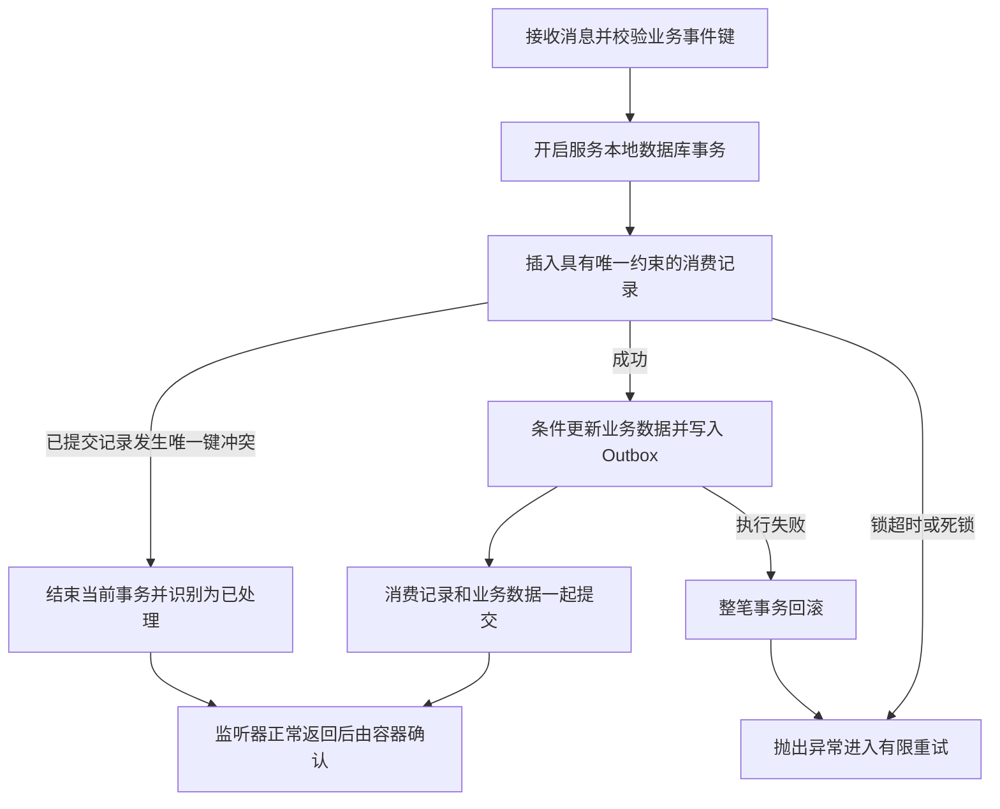

# 课程、交易、学习、促销、点赞服务 MQ 消费幂等性优化方案

本文基于 2026-10-14 当前工作区代码制定，属于设计方案，尚未实施业务代码和数据库变更。

建议采用：**稳定的业务事件键 + 消费记录与业务写入的同库事务 + 业务唯一约束/条件更新**。需要继续发消息或更新 Redis 时，增加本地 Outbox 和可重复执行的投影任务；点赞总数采用版本控制处理乱序。

## 1. 范围与现状

业务范围限定为 `tj-course`、`tj-trade`、`tj-learning`、`tj-promotion`、`tj-remark`。必要的公共组件放在 `tj-common`，共享消息字段放在 `tj-api`；不要求改造其他微服务的消费者或支付服务的生产逻辑。

在上述范围中发现 9 个有效的 `@RabbitListener` 入口：交易 3 个、学习 5 个、促销 1 个。课程、点赞服务未发现有效的 MQ 消费监听器，涉及它们的改动主要是消息标识、快照版本和可靠发送。

| 服务 / 消费入口 | 当前行为及风险 | 建议事件键与保障方式 |
| --- | --- | --- |
| 交易：支付成功 `trade.pay.success.queue` | `handlePaySuccess()` 无条件 `updateById()`，重复更新订单、明细并重新发送报名事件；迟到消息可能覆盖后续状态 | `PAY_SUCCESS:{bizOrderId}`；订单 `NO_PAY → PAYED` 条件更新，消费记录、明细和报名 Outbox 同事务 |
| 交易：退款结果 `trade.refund.result.queue` | 重复写退款状态，成功结果重复发送退课事件；旧失败结果可能覆盖成功结果 | `REFUND_RESULT:{bizRefundOrderId}:{status}`；退款状态机、条件更新、退课 Outbox 同事务 |
| 交易：延迟查单 `trade.delay.order.query` | 有待支付状态检查，但同轮重复消费会派生多个下一轮消息；修改原 DTO 会影响本地重试 | `PAY_QUERY:{queryTaskId}:{attempt}`；同轮查单任务去重，下一轮任务持久化，使用新的 DTO |
| 学习：支付加课 `learning.lesson.pay.queue` | `addUserLessons()` 直接批量插入；重复可能生成多行，也可能因数据库已有唯一键而持续失败 | `LESSON_GRANT:{orderId}:{courseId}`；逐项授权唯一约束，消费记录与课表写入同事务 |
| 学习：退款退课 `learning.lesson.refund.queue` | 按用户、课程直接删除；重复删除本身通常无副作用，但迟到的旧退款会删除重新购买的权限 | `LESSON_REVOKE:{refundApplyId}:{courseId}`；基于原订单授权撤销，保留退款状态防止迟到支付重新授权 |
| 学习：签到积分 `sign.points.queue` | 每次新增积分，再执行 Redis `ZINCRBY`；重试可能重复奖励或账本、榜单不一致 | `SIGN_POINTS:{userId}:{signDate}`；积分来源唯一约束，账本和榜单投影任务同事务 |
| 学习：问答积分 `qa.points.queue` | 消息只有 `userId`，无法区分同一用户的多次合法回答 | `QA_POINTS:{replyId}`；补充回答 ID、发生时间，积分来源唯一约束 |
| 学习：点赞数 `qa.liked.times.queue` | 批量设置总数，对同一快照重复写天然幂等，但旧快照可能覆盖新快照 | 每条数据携带 `(bizType, bizId, version)`；仅更新较新版本 |
| 促销：领券/兑换 `coupon.receive.queue` | `issue_num + 1`、新增用户券、更新兑换码；重复消息仍可能再发一张券，库存判断不能识别重复 | 普通领取 `COUPON_RECEIVE:{receiveRequestId}`；兑换 `COUPON_EXCHANGE:{serialNum}`；唯一请求、库存和发券同事务 |

代码依据：

- `tj-trade/.../handler/PayMessageHandler.java`：33、43、53 行为三个入口。
- `tj-trade/.../service/impl/OrderServiceImpl.java:426`：支付成功无条件更新并发送消息。
- `tj-trade/.../service/impl/RefundApplyServiceImpl.java:handleRefundResult`：退款结果直接更新并发送退课消息。
- `tj-trade/.../service/impl/PayServiceImpl.java:106`：延迟查单状态检查、重发及后续支付成功调用。
- `tj-learning/.../mq/LessonChangeListener.java`、`LearningPointsListener.java`、`LikeTimesChangeListener.java`：五个有效入口，忽略已注释的旧监听器。
- `tj-learning/.../service/impl/LearningLessonServiceImpl.java:74`、`:194`：直接加课、按用户课程退课。
- `tj-learning/.../service/impl/PointsRecordServiceImpl.java:44`：积分落库后直接增加 Redis 分数。
- `tj-promotion/.../service/impl/UserCouponLuaServiceImpl.java:178`：当前实际发券消费实现；旧 `UserCouponServiceImpl`、`UserCouponMqServiceImpl` 已注释。
- `tj-remark/.../service/impl/LikedStatServiceImpl.java:30`：更新本地统计后发送总数快照。

## 2. 事件标识：同时防止重复投递和重复发布

当前 `MqConfig` 已设置 `Jackson2JsonMessageConverter.setCreateMessageIds(true)`，因此不是完全没有消息 ID。问题是重新调用 `RabbitMqHelper.send()` 转换并发布消息时，可能产生新的 `messageId`，单靠它只能覆盖部分重复场景。

`CorrelationData.id` 用于发送确认，`REQUEST_ID_HEADER` 用于链路追踪，都不能代替业务幂等键。同一个请求可能产生多个合法事件，重试也可能属于不同请求。

约定三个概念：

- `eventId`：生产端创建一次并保存，同一事件的重发、错误队列回放继续使用原值。
- `eventKey`：由事件类型和业务身份生成，用于识别同一业务操作的重复发布，见上表。
- `consumerId`：稳定的逻辑处理器名称，例如 `learning.points.sign`。不使用实例 ID，也不因扩容、换队列或常规发布而更换名称。

唯一范围是 **`(consumerId, eventKey)`**。同一事件发给不同逻辑消费者时，各消费者都应完成自己的处理。

给 `RabbitMqHelper` 增加带显式 `eventId` 的发送重载，用消息属性/header 携带标识，保留原发送接口供其他业务使用。公共组件按监听器显式接入，避免改变范围外消费者的事务和确认行为。

需要新增或调整的业务字段：

| 消息 | 新字段 / 调整 |
| --- | --- |
| `UserCouponDTO` | `receiveRequestId`、`occurredAt`；兑换继续使用已有 `serialNum` |
| `SignInMessage` | `signDate`、`occurredAt`；日期由签到发生时确定 |
| 问答积分消息 | 将裸 `Long userId` 升级为含 `replyId`、`userId`、`occurredAt` 的 DTO |
| `OrderBasicDTO` | 退课增加 `refundApplyId`，授权关联原 `orderId` / 订单明细身份；携带确定的授权时间和有效期信息 |
| `OrderDelayQueryDTO` | `queryTaskId`、`attempt`；避免靠可变的剩余延迟数组标识轮次 |
| `LikedTimesDTO` | 每条增加 `version`，在批次路由上下文中明确 `bizType` |

两个不能直接采用的业务键：

- 优惠券不能统一以 `(userId, couponId)` 去重：当前有 `userLimit`，允许同一用户合法领取多张。
- 退款不能只以 `orderId` 去重：一个订单可能包含多个课程并分别退款；退款结果也有 RUNNING、FAILED、SUCCESS 等不同阶段。

支付和退款结果可直接用现有业务字段生成事件键，无须要求修改 `tj-pay`。

## 3. 数据库消费记录与业务操作一起提交

在 `tj_trade`、`tj_learning`、`tj_promotion` 各自数据库创建消费记录表，不使用一个跨库中心表。课程、点赞服务当前没有消费者，无须为了统一形式添加空的消费记录表。

以下为建议 DDL，实施时纳入项目实际使用的数据库迁移流程：

```sql
CREATE TABLE mq_consume_log (
    id BIGINT NOT NULL AUTO_INCREMENT,
    consumer_id VARCHAR(64) CHARACTER SET ascii COLLATE ascii_bin NOT NULL,
    event_key VARCHAR(192) CHARACTER SET ascii COLLATE ascii_bin NOT NULL,
    event_id VARCHAR(64) CHARACTER SET ascii COLLATE ascii_bin NULL,
    created_at DATETIME(3) NOT NULL,
    completed_at DATETIME(3) NULL,
    PRIMARY KEY (id),
    UNIQUE KEY uk_consumer_event (consumer_id, event_key),
    KEY idx_completed_at (completed_at)
) ENGINE=InnoDB DEFAULT CHARSET=utf8mb4;
```

事件键按固定 ASCII 格式编码并校验长度。此表采用“整笔事务提交才算完成”的模型：插入后执行业务，结束时写入完成时间，全部一起提交；业务失败则消费记录也回滚。无需将长期 `PROCESSING` 状态单独提交。



实现建议：第一版提供显式 `MqIdempotentExecutor`，通过 `TransactionTemplate` 包住消费记录和业务回调，比一开始叠加 AOP 注解更容易检查事务边界。公共接口接收 `consumerId`、`eventKey`、`eventId` 和业务回调；使用服务本地的数据源、事务管理器。

关键约束：

1. 必须先插入消费记录并依靠唯一约束竞争，不采用“查询不存在再插入”。
2. 并发的同键插入需等待前一事务：前一事务提交则识别为重复，回滚则后者可以处理；死锁和锁等待超时属于可重试失败。
3. 只有消费记录插入语句产生的预期唯一键冲突可映射为“已处理”。业务表约束异常不能被统一捕获后 ACK；避免使用会掩盖其他数据错误的 `INSERT IGNORE`。
4. 可在消费记录插入处将该冲突转换为专门异常，在整笔事务退出/回滚后识别。必须验证不会由于错误的嵌套事务处理留下 `rollback-only` 并假装成功。
5. 业务写入加入同一事务，不使用独立的 `REQUIRES_NEW` 先保存成功标记。远程查询可先读取必要信息，但远程写入和 Redis 写入不纳入此原子性承诺。
6. 服务方法的条件更新仍须保留：退款任务、主动查单、HTTP 调用等入口也可能直接调用业务方法，绕过 MQ 消费记录。

该方案解决两个崩溃窗口：业务执行中崩溃会整体回滚；提交后 ACK 丢失则重投时命中已提交记录。对业务本地数据库实现一次有效变更，跨服务依靠下游各自的幂等处理。

## 4. 各业务的具体落地方式

### 4.1 交易：状态机与 Outbox

支付成功首先校验结果确为 `SUCCESS`，订单 ID、支付流水等数据有效。以条件更新作为原子入口：

```sql
UPDATE `order`
SET status = 2, pay_order_no = ?, pay_channel = ?, pay_time = ?
WHERE id = ? AND status = 1;
```

状态值对应当前 `NO_PAY=1`、`PAYED=2`。只有影响行数为 1 时，才更新订单明细并生成报名事件。影响行数为 0 时读取当前状态，区分已处理、关闭订单的迟到支付以及数据缺失，不能一律当成成功重复。

关闭订单后收到真实支付成功，要记录异常并进入对账/补偿，不直接丢弃也不直接重新开放订单。重复回调不能把已完成或已退款明细重新写为支付状态。

退款根据业务申请 ID 和结果阶段去重，普通终态更新从 `AGREE` 条件迁移。`SUCCESS` 不被迟到的 RUNNING/FAILED 覆盖；FAILED 后收到矛盾的 SUCCESS 时，查询支付侧权威状态并走显式补偿，不按到达顺序覆盖。只有第一次有效迁移到成功才写入退课 Outbox。

**订单/退款状态、明细变更和 Outbox 插入必须同事务完成。** 后台发送器投递 Outbox，并在 broker confirm 和必要的路由返回检查通过后标记已发送。发送后、标记前崩溃会重发，因此持续使用原 `eventId`，下游仍需去重。

仅在事务提交后用回调 `send()`，仍可能在提交与发送之间宕机，不能代替持久化 Outbox。

延迟查单还有一个需要优先修复的现有逻辑错误：`PayServiceImpl.queryPayResult()` 在支付未成功时调用 `sendDelayQueryMessage()` 后，没有结束分支，随后仍调用 `handlePaySuccess()`。应明确返回，只有成功结果才能进入支付成功处理。

查单按 `queryTaskId + attempt` 建立任务记录。网络查询在数据库长事务外执行，处理结果和创建唯一的下一轮任务在短事务中完成。下一轮事件用新 DTO、新 `eventId`；同轮重发保留原事件身份。延迟发送 Outbox 保存计划执行时间，重发时使用剩余延迟。

### 4.2 促销：一次领取请求只发一张券

普通领取增加稳定的 `receiveRequestId`，同次领取的发布重试沿用该 ID；它需要与领取预占结果一起保留，不能重发时重新生成。

在用户券表增加领取来源字段及唯一约束，或建立发券请求明细表，以请求 ID 唯一关联生成的用户券。兑换以 `serialNum` 唯一关联发券结果。

消费事务顺序：消费记录插入 → 请求/兑换身份校验 → 库存条件更新 → 用户券插入 → 兑换码条件变更 → 一起提交。用户券保存失败必须抛出异常，不能忽略 boolean 返回值。

保留当前 `couponMapper.incrIssueNum()` 中的 `issue_num < total_num`，它负责库存安全；消费记录和请求唯一约束负责防重。兑换码只允许从未使用状态条件更新，影响行数不符合预期时整笔回滚并判断是否已经由同一请求兑换。

现有 Redis Lua 的库存预占不与 MySQL/MQ 原子提交。消费幂等可防重复发券，但不能单独修复“Lua 扣了库存，消息却未可靠发出”的遗漏。建议保留可扫描的领取预占记录和原事件 ID，增加发送补偿与预占、落库对账；补偿按请求 ID 条件执行，避免消息晚到后重复退库存。

### 4.3 学习课表：授权按订单关联，退款留下状态

为每项课程权益保存原 `orderId` / 订单明细身份，建议新增 `learning_entitlement`，唯一约束为 `(order_id, course_id)`，记录用户、授权时间、有效期、是否已退款。

支付事件只对相应权益授权一次；退款只撤销原权益。退款先到时插入/更新“已退款”的权益记录，支付晚到也不能重新启用这项权益。对同一权益并发支付/退款使用行锁或条件更新保证此规则。

`learning_lesson` 继续作为用户课程和学习进度的视图。如保持一人一门课一行，核查现有数据后建立 `(user_id, course_id)` 唯一约束，从有效权益更新访问权限，避免重复事件重置进度、延长有效期。旧退款不能撤销另一笔新订单提供的权益。

使用事件中确定的支付/授权时间计算有效期，避免消费重试时用 `LocalDateTime.now()` 重新起算。当前代码有“课表按月、订单明细按分钟”计算有效期的差异，实施时须核对并统一单位。

加课需要的课程查询失败或结果不全时，不应直接正常返回并留下已处理记录；应区分临时故障与无效消息，重试或隔离，避免只加一部分课却 ACK 整个订单。

一个订单多门课，可以整单同事务处理，也可以按课程拆分事务；若采用逐项处理，必须逐项保存事件键，已完成项在整消息重试时能够跳过。

### 4.4 学习积分：账本只记一次，Redis 可以重建

积分账本增加来源类型和来源业务 ID 的唯一约束；签到来源是用户与原签到日期，问答来源是回答 ID。当前 QA 消费消息只有用户 ID，且在检查的学习代码中未找到对应 `WRITE_REPLY` 生产调用，实施前核对真实消息来源。

积分事务写入：消费记录、积分明细、用户当期积分汇总及版本、Redis 榜单投影 Outbox。账本成功后，监听器就可确认，由可重试的投影任务更新榜单。

Redis 改为“绝对总分 + 版本”投影：发送 `{userId, season, totalPoints, version}`；Lua 原子比较版本，仅当传入版本更大时更新 `ZADD` 分数和版本。这样同任务重试不再重复加分，乱序任务也不能回退分数。

汇总版本在 MySQL 中按用户、赛季串行递增，不能通过消费端时钟生成。Redis 只是投影，可由数据库汇总重建；Redis 数据或版本丢失后的恢复，以数据库最新总分、版本重建并协调在途投影任务。若采用 Redis Cluster，脚本涉及的榜单和版本 key 必须同槽。

签到日期、每日上限和赛季归属基于事件发生时间，不能基于消费时的当前日期。每日上限还需在同一用户、日期、积分类型维度串行更新，防止不同合法事件并发越过上限。

积分归档/清零不能同时抹去仍可能被回放的来源去重凭据；跨月重放需要检查原赛季及持久化凭据。

### 4.5 点赞与课程：快照加版本，事件可靠发送

点赞消息传输的是绝对总数，不需要改成累加。每条 `LikedTimesDTO` 增加针对 `(bizType, bizId)` 的递增版本，学习库保存已应用版本：

```sql
UPDATE interaction_reply
SET liked_times = ?, liked_version = ?
WHERE id = ? AND liked_version < ?;
```

新版本更新，相同/旧版本直接跳过。不能使用 `MAX(liked_times)`：取消点赞会使合法的新总数下降。批次每项独立比较版本，不以整个批次 ID 代替实体版本。

版本与总数快照必须在同一权威写入点产生。当前点赞源在 Redis 中，要避免“先读旧总数、后在数据库分配新版本”把旧数据包装成新版本：建议在点赞/取消操作时通过 Lua 原子更新状态、总数和实体版本，再原子读取总数与版本形成快照；保证版本持久化及 Redis 重建后不会倒退。

当前 `readLikedTimesAndSendMessage()` 先 `popMin()` 移除待同步项，随后更新数据库、发送 MQ。应增加可恢复的待处理队列/处理中集合或可靠投递记录，失败后恢复任务，重发时不得拿旧快照覆盖新快照。数据库统计保存与其 Outbox 可在本地事务中一起完成，但这仍需衔接好 Redis 到数据库的可恢复移交。

课程服务目前只发送上架、下架、删除等事件。为事件增加稳定的 `eventId`，并用 `(courseId, revision, eventType)` 标识一次变更；同一课程多次上下架需要不同 revision。修改课程状态和保存 Outbox 同事务。本次不扩展到搜索等范围外消费者。

## 5. ACK、重试及失败回放

不要求为了幂等统一切换手动 ACK。对同步监听器，可以使用 Spring `AUTO`：本地事务已提交、或已确认是完成过的重复事件后正常返回；临时失败抛异常，由容器进入重试。Spring 的 `AUTO` 与 broker 收到即确认的 `NONE` 不同。[Spring AMQP 2.4 监听容器说明](https://docs.spring.io/spring-amqp/docs/2.4.x/reference/html/#containerAttributes)

建议初始采用有限次数的指数退避，例如最多 3 次尝试，1 秒、2 秒间隔；参数按依赖恢复时间和吞吐量再调。无效字段、未知事件类型进入隔离处理，禁止日志后直接返回造成静默丢失。数据库暂时不可用、死锁、网络超时保留原事件键重试。

当前 `MqConfig` 已配置 `RepublishMessageRecoverer` 和各服务错误队列。核对 publisher confirm、mandatory/return 配置，考虑改用兼容当前依赖的 `RepublishMessageRecovererWithConfirms`；确认错误消息可靠移交后才允许结束原消费。[Spring AMQP 异常处理与重发恢复](https://docs.spring.io/spring-amqp/docs/2.4.x/reference/html/#exception-handling)

实际 MQ 参数来自 Nacos `shared-mq.yaml`，仓库没有其内容，不能从代码确定当前 ACK 模式和重试参数。交易、促销的 `tj.mq.listener.retry.stateless` 在仓库中未找到绑定实现，应核对其是否生效以及标准 `spring.rabbitmq.listener.simple.retry.*` 配置；“有状态重试”管理重试过程，不等于业务幂等。

错误队列按服务汇总，回放须保留原交换机、routing key、`eventId`、业务字段和事件键；不能用新 ID 将原事件包装成另一操作。对同键但关键业务数据冲突的消息报警并隔离，禁止以普通重复掩盖。

日志至少包含 `consumerId`、`eventKey`、`eventId`、`requestId`、重试次数、处理结果。指标覆盖重复率、事务失败率、状态冲突、错误队列积压、Outbox 积压时长和投影延迟。

## 6. 实施顺序与迁移

1. **先建立可靠消费基础。** 明确事件键，在交易、学习、促销库建立消费记录和业务来源唯一约束；落地公共执行器，优先修复延迟查单分支、支付/退款条件迁移、发券去重。交易的下游发送同时接入 Outbox，避免状态保护导致补发机会丢失。
2. **完成课表和积分保障。** 增加订单权益关联、退款状态、积分来源字段；账本、汇总、投影任务一起提交，替换直接 Redis 累加。
3. **补全消息契约及快照版本。** 发布消费者兼容代码，再升级范围内生产端；最后启用新字段必填和严格校验。完成点赞版本与可恢复移交、课程可靠事件发送。
4. **用故障注入验收后逐队列启用。** 对比重复率、业务唯一结果、Outbox 和错误队列积压，确认旧消费者全部退出；混跑期间旧实例仍会造成重复写，不能宣称保障已经生效。

迁移约束：

- 落地前通过实际 `SHOW CREATE TABLE` 检查现有索引、重复数据和字段。本仓库没有完整业务库 DDL，不能假定线上没有唯一索引。建立约束前清理历史重复并保留业务关联。
- 旧支付/退款事件可由现有业务字段生成键；旧领券、签到、QA 消息缺少请求 ID、日期或回答 ID，只能临时借助原 `messageId` 防重投，无法可靠防止新 ID 的业务重复发布。必要时先暂停并排空/隔离旧队列，再启用新契约；不能用消费日期或随机 ID 冒充稳定业务键。
- 新去重表不自动代表历史操作已登记。历史回放要先从订单状态、权益、发券记录、积分来源补齐可证明的凭据；身份无法恢复时进入对账，避免再次执行历史增量操作。
- 消费记录保留期至少覆盖 broker 重试、错误队列留存和人工回放窗口。积分、发券等增量操作长期依靠业务来源唯一约束或独立持久化凭据，不因日志清理恢复重复执行的可能。
- 变更采用队列级接入和开关；发生问题时暂停消费、保留事件和去重凭据，避免通过关闭保护重放同一批数据。

## 7. 验收场景

| 场景 | 应满足的结果 |
| --- | --- |
| 同一事件顺序投递 10 次、多个实例同时投递 | 积分/发券/授权等业务只生效一次；重复可正常确认 |
| 相同业务事件使用不同 messageId 再次发布 | 业务事件键仍能识别重复，不依赖传输 ID |
| 同一事件送给两个不同逻辑消费者 | 两个消费者分别完成自己的操作 |
| 业务 SQL 完成后、事务提交前宕机 | 消费记录和业务全部回滚，重投能完成 |
| 事务提交后、ACK 前宕机 | 重投命中消费记录，不重复执行 |
| 并发事务的首个处理者失败 | 后续实例可以处理，不因过早成功标记丢失业务 |
| 支付未成功的延迟查询 | 只调度下一轮，不进入支付成功逻辑；同轮不派生多个有效任务 |
| 退款成功后收到旧失败消息 | 成功状态和课程权益不回退；矛盾结果进入核实 |
| 退款先到、支付事件后到 | 对同一原订单权益仍保持已退款，不重新加课 |
| 用户再次购买后收到旧订单退课事件 | 新订单的合法课程权益保留 |
| 同一用户合法领取两张同模板券 | 两次不同请求均成功；同次请求重试仍只发一张 |
| Redis 更新失败、Outbox 重发或任务乱序 | 积分账本不重复，榜单最终等于数据库汇总 |
| 点赞版本依次收到 v2、v1、v2，v2 总数更低 | 保留 v2 总数；允许取消点赞造成下降 |
| 跨日/跨月迟到事件和归档后的回放 | 按原日期、赛季入账，仍能阻止重复奖励 |
| Outbox 发送成功后、标记前宕机 | 重发保留事件身份，下游只生效一次 |
| 无效消息、数据库故障、错误队列回放 | 无静默丢失；回放保持原身份；失败移交可验证 |

上述应在真实 MySQL、Redis 和 RabbitMQ 的集成环境执行，覆盖唯一约束等待、事务回滚、broker 重投和进程退出；只 mock 调用次数无法证明崩溃窗口正确。

RabbitMQ 的可靠交付允许故障重投和发送重传导致重复，消费者需要承担幂等处理。[RabbitMQ Reliability Guide](https://www.rabbitmq.com/docs/reliability)
