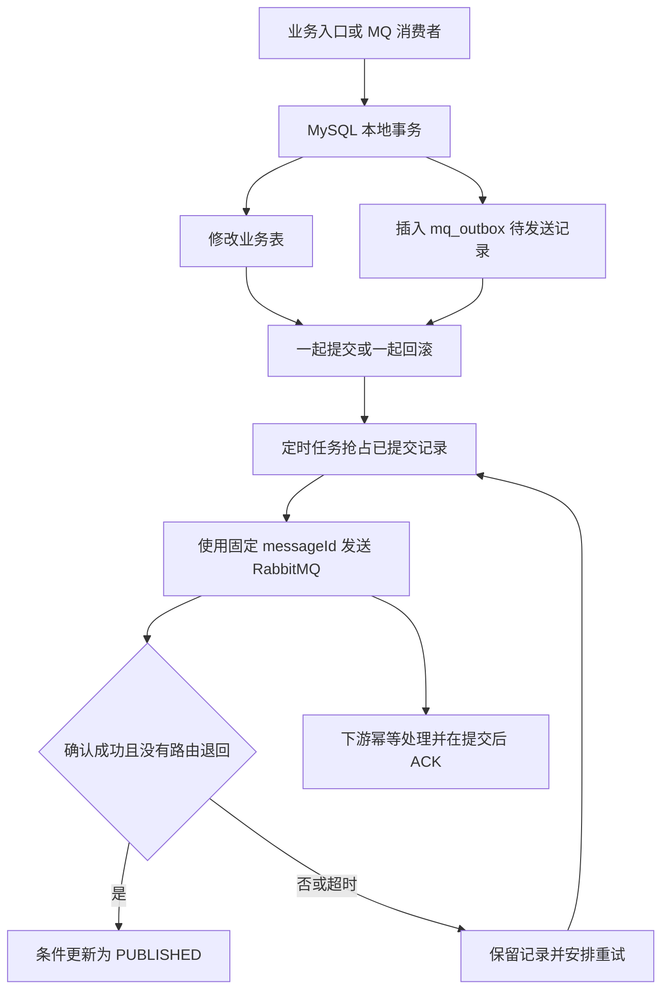

# 五个微服务的本地消息表与定时补发方案

本方案只针对课程、交易、学习、促销、点赞五个微服务。基于当前代码制定设计，尚未修改业务代码或执行数据库迁移。

## 1. 目标与保证范围

推荐采用事务 Outbox：业务表与本地待发送消息表使用同一数据源、同一个 MySQL 本地事务，事务提交以后，由定时任务发送消息。

必须准确区分两个保证：

- **原子提交**：业务数据与“需要发送这条消息”的记录一起成功，或者一起回滚。
- **最终发送**：已经提交的消息记录持续补发，在数据库、调度器、RabbitMQ 和路由恢复可用后，最终被正确路由并确认。

MySQL 提交和 RabbitMQ 实际接收仍是两个动作，存在暂时只有数据库成功的状态。本方案不提供两者在同一时刻原子成功的分布式事务；API 成功表示业务和发送任务已经可靠落库，下游可能稍后完成。如果要求 API 返回成功时下游也已完成，需另外设计业务完成状态与回执，等待 broker confirm 也不能代表下游业务成功。

这符合 [AWS 的事务 Outbox 模式](https://docs.aws.amazon.com/prescriptive-guidance/latest/cloud-design-patterns/transactional-outbox.html)：把业务变更和事件一起写入本地事务，再独立投递。重投可能发生，因此仍需要已有消费幂等机制。

不把 Redis 操作、远程 HTTP 调用、其他微服务数据库纳入同一个本地事务。Redis 与 MySQL 同时写入的入口单独列出，不能通过增加一张 Outbox 表宣称已经解决。

## 2. 整体流程



例如支付成功处理改成：

```java
@Transactional(rollbackFor = Exception.class)
public void handlePaySuccess(PayResultDTO result) {
    // 保留现有 NO_PAY -> PAYED 的条件更新。
    // 已完成的重复通知返回；并发冲突抛异常，在新事务重试。
    updateOrderAndDetails(result);

    // 只落库，不在这个事务里调用 RabbitMQ。
    outboxService.record(
        "ORDER_ENROLLED",
        "order:" + result.getBizOrderId(),
        ORDER_EXCHANGE,
        ORDER_PAY_KEY,
        buildOrderBasicDTO(result)
    );
}
```

以上是流程示意，不是可直接替换的完整业务实现。Outbox 插入失败必须抛异常，让订单和明细一起回滚；业务 CAS 未成功不能创建新事件。业务事务内不等待网络发送，不使用 afterCommit 回调承担唯一的消息持久化责任。

对于消费后继续发送的入口，链路为“消费防重或状态 CAS + 本地业务 + Outbox”一起提交，再 ACK 原消息。以后补发依靠 Outbox，不依靠重新执行已经完成的原业务。

## 3. 本地消息表与事件身份

各服务在自己的业务库建立 `mq_outbox`。不能统一写入一个独立公共消息库，否则业务表和消息表失去同一本地事务。`tj-common` 只提供可显式启用的组件，五个服务按需接入；其他服务继续使用现有发送方式。

建议字段：

| 字段 | 用途 |
| --- | --- |
| id | 表内递增主键，方便分页扫描 |
| event_id | 一次业务事件的固定消息 ID；创建时生成并持久化，所有发送重试沿用 |
| event_type、biz_key | 唯一业务事件身份，唯一约束 `(event_type, biz_key)` |
| aggregate_id、business_version | 业务实体与源版本；需要顺序语义的事件使用，其他事件可不填版本 |
| exchange_name、routing_key | 固定的投递目标 |
| payload、headers、content_type | 已序列化的消息正文、必要的类型与追踪头；重试不重新查询业务数据构造消息 |
| available_at | 最早允许发送的时间，支持本地持久化延迟任务 |
| status | `PENDING`、`PUBLISHING`、`PUBLISHED` |
| attempts、next_retry_at | 发送尝试次数与下次补发时间 |
| lock_token、locked_until | 本次抢占的令牌与租约到期时间 |
| last_error | 最近失败原因，限制长度 |
| created_at、updated_at、published_at | 创建、更新与确认完成时间 |

表使用 InnoDB。事件 ID、业务键建议使用有长度限制的 ASCII 区分大小写字段。唯一索引包括 `event_id` 和 `(event_type, biz_key)`，调度索引包括 `(status, next_retry_at, id)` 和 `(status, locked_until, id)`。`payload` 可使用 LONGBLOB，消息头使用文本存储；实施前核实实际 MySQL 版本与现有字符集，无需依赖 MySQL 8 的 SKIP LOCKED。

使用当前 Jackson 消息转换器在落库时完成序列化，并保存接收方反序列化所需的类型头。正文格式保持与现有消费者兼容，不随意改成统一包装 DTO。发送时重建原始 `Message`，显式设置 `messageId = event_id`、持久化投递模式，以及可选 `eventId` 头；不让每次转换重新生成 UUID。

`event_id` 可以是 UUID，关键在于首次创建后永久沿用。`CorrelationData.id` 则使用 `event_id + 本次 lock_token`，区分各次发布尝试；它是发送确认关联 ID，不是消费去重 ID，也不是 MDC 的请求追踪 ID。

业务键建议：

| 事件 | 业务键 |
| --- | --- |
| 免费报名、支付成功后的加课 | `order:{orderId}`，共用报名事件类型，同一个订单只产生一次报名事件 |
| 退款成功后的退课 | `refund:{refundApplyId}`；明细信息同时包含原订单、课程，后续权益改造可使用 orderDetailId |
| 课程上架、下架、完结、删除 | `course:{courseId}:version:{eventVersion}`，事件类型区分操作 |
| 普通领券请求 | `receive:{receiveRequestId}`，沿用一次合法请求的固定 ID |
| 兑换领券请求 | `exchange:{serialNum}` |
| 点赞快照 | 优先 `biz:{bizType}:{bizId}:version:{sourceVersion}`；版本尚未补全时只用持久化的本次批次 ID，保证发布重试去重，不能声称解决旧快照乱序 |
| 查单的下一轮调度 | `query:{queryTaskId}:round:{round}`，同轮重复通知不能创建不同任务 |

课程可多次上下架，不能只用 courseId 防重。现有 publishTimes 只反映发布次数，不能直接作为覆盖所有操作的版本。建议同事务递增专用事件版本，必要时放到独立序列表，删除课程后仍保留版本身份。

生产端重复业务调用要先通过业务状态 CAS、唯一业务请求或版本判断是否已完成。Outbox 唯一键是第二道检查，不自动让业务本身幂等；重复键也不能无条件吞掉。如果发现同一事件键对应不同载荷，视为身份冲突并回滚、报错。

## 4. 定时补发与 RabbitMQ 成功判定

### 4.1 多实例抢占

优先复用项目已有的 XXL-JOB；每个服务独立扫描自己的表。建议初始每 1～5 秒触发，每轮最多取 100 条，实际并发和频率按积压与数据库负载调整。低延迟链路可使用 1 秒扫描，不把这些参数视为已经压测过的结论。

扫描到候选记录后，通过条件更新抢占：

```sql
UPDATE mq_outbox
SET status = 'PUBLISHING',
    lock_token = :attemptToken,
    locked_until = :leaseUntil,
    attempts = attempts + 1,
    updated_at = :now
WHERE id = :id
  AND status = 'PENDING'
  AND available_at <= :now
  AND next_retry_at <= :now;
```

只有影响 1 行的实例发送。抢占和状态回写使用短事务，RabbitMQ 网络发送在事务外进行。每次真正准备发送才抢占，不提前租下过大批次。租约应大于确认等待时间并留出回写余量，例如确认等 5 秒、租约 30 秒；慢任务可续租，所有条件比较尽量统一数据库时钟。

实例宕机后，扫描过期的 `PUBLISHING`，条件更新为 `PENDING` 并清除旧令牌。确认成功、失败重试以及续租的回写都带 `id + status + lock_token` 条件。旧实例迟到的回调不能修改另一实例已经接手的状态。

这种抢占减少并发重复发送，但不能消除发送结果未知时的重发，消费端仍需幂等。

### 4.2 不能把 send() 正常返回当成已经发送成功

当前 `RabbitMqHelper.send()` 调用 `convertAndSend()` 后直接返回；它创建了 CorrelationData，但没有等待并核实 publisher confirm。`setReplyTimeout(500)` 不等于等待发布确认；`sendAsync()` 还会把异常记录到日志后结束，内存任务不能承担可靠补发。

需要给 Outbox 单独提供确认发送器，不全局改变其他微服务的 helper 行为：

- 启用 `publisher-confirm-type: correlated`。
- 启用 `publisher-returns: true`，并设置 `mandatory: true`。
- 发送持久化消息，核实 exchange、目标 queue 和 binding 的持久化及正确性。
- 使用 Spring AMQP 2.4.6 的 `CorrelationData.getFuture()` 等待确认，并检查 `getReturned()`。
- 仅当 confirm ACK 且没有 ReturnedMessage 时，条件更新为 `PUBLISHED`。
- 异常、NACK、路由退回、确认超时都保留消息并安排重试；超时表示结果未知，不意味着 broker 一定没收到。

[RabbitMQ 官方说明](https://www.rabbitmq.com/docs/confirms)：没有路由到任何队列的消息也可能收到 confirm ACK，因此必须同时检查 return。发布确认只覆盖 broker 接收，不覆盖下游业务完成。[Spring AMQP 2.4.6 的 CorrelationData](https://github.com/spring-projects/spring-amqp/blob/v2.4.6/spring-rabbit/src/main/java/org/springframework/amqp/rabbit/connection/CorrelationData.java)支持按此次发布关联确认和路由退回。

ACK 且无 return 只表示消息被实际路由，不能证明所有预期下游的绑定都存在。关键绑定需要部署前校验。课程事件可能被范围外服务消费，本次保证五个服务的可靠发布，不修改范围外消费者，也不承诺它们的业务执行结果。

### 4.3 重试、归档与运维

建议退避为 5 秒、15 秒、30 秒、1 分钟、5 分钟，之后持续低频重试，并加入少量随机抖动。消息失败不能阻塞同一批其他消息，也不能因达到次数上限而删除、标为已成功或静默停止。

超过时间或次数阈值告警；永久配置错误保留可查询、可恢复记录，修复后沿用原 eventId 重投。监控待发送数、最老待发送时间、确认超时、路由退回和过期租约。对于某个实体严格有序的链路，卡住该实体的后续事件而非全局队列；或者由接收方按源版本与业务状态规则拒绝过期事件。

PUBLISHED 表示已获 broker 确认，不表示下游已消费。只有成功记录按约定留存期归档；待发送、重试中记录不清理。消费幂等记录的保留期要覆盖生产端补发、错误队列重放及人工回放窗口。归档 Outbox 后若还需要防止业务重复创建同一事件，业务状态或持久化事件身份不能同时被删除。

## 5. 五个微服务的具体接入点

| 服务 | 当前链路 | 设计动作与保证边界 |
| --- | --- | --- |
| 课程 | CourseDraftServiceImpl.upShelf / downShelf 修改课程后发送上下架事件 | 原事务内改为插入 Outbox；保留同库其他表修改，校验写入结果，补充业务条件更新及事件身份 |
| 课程 | CourseServiceImpl.delete 调用草稿删除事务，随后发送删除事件 | 在外层 delete 建立事务，让草稿删除与 Outbox 共同提交；不能让内部先独立提交 |
| 课程 | CourseServiceImpl.courseFinished 修改状态后 sendAsync | 改为状态迁移成功才生成 Outbox；状态、相关草稿清理与消息记录共同提交，取消这条链路的内存异步发送 |
| 交易 | OrderServiceImpl.enrolledFreeCourse | 新建订单、订单明细与报名 Outbox 一起提交 |
| 交易 | OrderServiceImpl.handlePaySuccess | 保留现有乐观锁，订单和明细成功后同事务生成报名 Outbox；原支付通知在事务提交后 ACK |
| 交易 | RefundApplyServiceImpl.handleRefundResult | 保留退款状态乐观锁，退款申请、明细和成功退课 Outbox 一起提交；失败/处理中不创建成功退课事件 |
| 交易 | PayServiceImpl 延迟查询及下一轮派生 | 增加持久化查询任务与轮次，下轮进度和下轮 Outbox 一起提交；详见下一节 |
| 学习 | 支付加课、退款退课、点赞计数消费 | 现有入口主要是落库消费，没有继续发送 MQ；沿用已有消费幂等。未来如需发事件，纳入该消费事务的 Outbox，不为接入而增加无业务用途的消息 |
| 学习 | SignRecordServiceImpl 签到 | 当前修改 Redis bitmap 后发消息，没有 MySQL 签到事务；不能直接满足本方案的本地事务前提，详见下一节 |
| 学习 | InteractionReplyServiceImpl.saveReply | 当前代码保存回答/评论，但没有实际发布 reply.new。不能把已有问答积分监听器当成已有发送链路；新增积分事件需另外确定业务条件、回答 ID 和事件日期 |
| 促销 | UserCouponLuaServiceImpl.receiveCoupon / exchangeCoupon | 当前 Redis Lua 预占/兑换后发消息，MySQL 发券在消费者；仅加 Outbox 不能使 Redis 操作与 MySQL 插入原子，详见下一节 |
| 点赞 | LikedStatServiceImpl.updateLikedTimes 落库后发布快照 | 增加外层本地事务，把整个统计批次与 Outbox 一起提交，保存固定快照及消息 ID；Redis 取数与首次乱序仍需额外处理 |

本地事务要求同一事务管理器和 Spring 代理真实生效。Outbox 记录方法建议使用 `Propagation.MANDATORY`，缺少业务事务就直接失败，不自动单独提交；不能使用 REQUIRES_NEW 或新线程写消息记录。MyBatis 批量写入必须检查失败结果，并在返回前完成落库。课程存在远程调用和 GlobalTransactional 注解，本方案仅保证本服务 MySQL 与 Outbox 的关系，不延伸到远程考试等资源。

## 6. 必须单独处理的链路

### 6.1 交易延迟查单

当前使用 `trade.delay.topic` 的 x-delayed-message 交换机。延迟插件对 mandatory 和延期期间的存储有额外限制，不能把普通 exchange 的“ACK 且没有 return”直接套用为未来成功路由的保证。官方 [延迟插件说明](https://github.com/rabbitmq/rabbitmq-delayed-message-exchange#limitations)给出了这些限制，实际部署版本仍需核实。

建议让 MySQL 保存延迟时间，到 `available_at` 再投递到新的普通 topic exchange，例如 `trade.query.topic`，沿用 `delay.order.query` routingKey。消费者先增加新绑定，迁移期间保留旧延迟队列和旧消息消费能力；新生产者切换后，新任务不再重复设置 x-delay，避免每次补发重新延迟或叠加等待时间。

增加 `pay_query_task`，包含 taskId、orderId、当前 round、下一次执行时间、终止状态。消费某轮查询时，在本地事务内条件推进轮次并插入下一轮 Outbox；已有消费唯一记录也可以作为轮次防重。初始查询任务需要唯一的活跃链路身份；重复申请支付不能无意创建多条并行查询链。

现有调用先向范围外支付服务申请支付，再安排本地查询。Outbox 无法原子覆盖这次远程调用。增加对未支付订单的定时核查，可在远程申请成功但本地进程提前退出时重建缺失的查询任务；这属于依据本地订单事实进行补偿，不是跨服务事务。

### 6.2 学习签到与积分

遵守之前“两个积分消费者保留原实现”的要求，本方案不把积分 MySQL + Redis 双写宣称为已解决，也不直接改造这两个入口。

如果后续选择先前讨论的签到改造，流程应为：

```text
MySQL 事务：签到记录 UNIQUE(userId, signDate)
           + 积分明细与必要的积分汇总
           + 发往 Redis 投影消费者的 Outbox

新消费者：按固定积分事件 ID 防重，更新 Redis 后 ACK
```

签到日期、月份、实际获得积分应在业务发生时固定。新的消息若用于更新 Redis，不能继续被旧签到积分消费者消费，否则同一笔积分会再次写入 MySQL；需规划独立路由及消费者迁移。Redis bitmap 可作为投影，但不能继续承担与 MySQL 同事务的签到事实。

Redis 投影可选择“eventId 去重 + 原子递增”或“源版本 + 总分覆盖”。还需考虑 Redis 丢失后的重建与对账。本方案解决的是 MySQL 与发布任务的原子关系，消费者写 Redis 的可靠性是另一层设计。

### 6.3 促销领券与兑换

现有顺序为“Redis Lua 成功 → 发 MQ → 消费者落 MySQL”。改成“Redis Lua 成功 → 写 MySQL Outbox”仍存在进程在中间退出的窗口，不能保证已预占的请求必然有消息。

若要求整个领券受理动作可靠，推荐以 MySQL 为最终受理依据：同事务记录有唯一请求 ID 的领券申请、持久化名额/限领约束或兑换占用状态，以及发券 Outbox；Redis 用于预筛或缓存。消费者将申请从待处理状态迁移为发放完成，与用户券、库存和已有消费记录一起提交。名额究竟在受理时预留还是在发券时最终占用必须统一，不能两端各扣一次。

这涉及原有高并发领券设计与吞吐取舍，不能作为“替换 send 方法”的小改动。若继续以 Redis 为权威，需要 Redis 内可靠事件日志与待确认预占、持久化和对账补偿等额外机制，普通 MySQL Outbox 单独做不到。

### 6.4 点赞 Redis 取数与乱序

当前 `readLikedTimesAndSendMessage()` 先 popMin 移除 Redis 待同步记录，再调用统计落库。即使给统计事务增加 Outbox，进程在 popMin 后、事务提交前退出，待同步记录仍可能丢失。

在保留 Redis 点赞实现的情况下，可增加待处理/处理中状态和超时重新认领；先可靠读取并认领快照，待 MySQL 统计与 Outbox 提交后，再按源版本条件清理 Redis 待处理标记，期间的新点赞不能被旧任务清除。点赞集合变化、总数、源版本及待处理标记应在同一个 Redis 原子操作内维护，但它依旧需要考虑 Redis 自身持久化、恢复和对账。

首次到达的旧快照仍需源版本：同一业务的统计值与版本必须在源头一致产生，MySQL 统计表和下游按版本条件更新。不能给迟到快照在落库时简单分配更大版本，不能用 UUID 或最大点赞数判新旧。

如果希望点赞请求本身也获得 MySQL 与消息原子保证，需要把点赞事实改为 MySQL 权威，按实际状态变更同事务更新统计/版本和 Outbox，Redis 作为投影。这是更大范围的业务改造。第一阶段只能保证“已进入统计事务的 MySQL 更新与快照发送任务”一起提交。

### 6.5 不同业务事件的顺序与权益归属

Outbox 的固定消息 ID 只解决同一事件的重发，不解决不同事件首次到达的顺序。不能仅按表内 id 排序就承诺端到端有序：多实例、重试和消费并发仍可能改变到达顺序。

现有学习课表没有原订单权益关联，旧订单退款首次迟到仍可能删除新订单购买的同一课程，退款先到再支付也可能重新加课。需要记录订单/订单明细的权益来源，并让退款终态在加课前到达时也能保留下来；Outbox 接入不代替这项业务模型调整。当前加课/退课的消费幂等保证保持原有范围。

## 7. 失败场景与恢复

| 失败位置 | 数据状态 | 恢复方式 |
| --- | --- | --- |
| 业务写入失败或 Outbox 插入失败 | 整个本地事务回滚 | API/原消息重试，不会向下游发送未提交事件 |
| 事务提交后，进程还没发送就宕机 | 业务和 PENDING 都已持久化 | 定时任务恢复后补发 |
| 抢占以后、网络发送前宕机 | 消息处于 PUBLISHING | 租约过期后重新抢占 |
| MQ 不可用、NACK、路由退回 | 发送没有可靠完成 | 保留记录并退避重试，路由错误告警 |
| broker 已收到，但 confirm 丢失 | 发布结果未知 | 同 eventId 重发，下游幂等处理 |
| confirm 成功，但状态回写失败或进程宕机 | broker 已收到，本地仍未完成 | 租约恢复后可能重发，下游幂等处理 |
| 租约过期后旧实例才拿到 ACK | 新实例可能已接手 | 旧令牌条件回写失败，不能污染新状态 |
| 下游已经提交但 ACK 丢失 | 原消息可能再次投递 | 已有消费记录或业务 CAS 识别重复，再 ACK |
| 下游业务失败 | Outbox 可能早已 PUBLISHED | 依靠消费重试、可靠错误队列与回放；不能把发布成功当作消费成功 |
| Redis 在创建 Outbox 之前成功，但进程宕机 | 本地数据库可能没有任何记录 | 普通 Outbox 无法恢复，必须采用上一节的业务改造或补偿 |

错误队列重发布本身也需要确认投递与可回放性，不能把处理失败的消息只记日志后丢弃。已有 RepublishMessageRecoverer 的运行配置需核实，不因为生产端用了 Outbox 就认为消费端不再需要可靠失败处理。

## 8. 实施顺序与验收

建议分阶段实施：

1. 建立可显式启用的 Outbox 记录器、确认发送器和数据库抢占补发任务；首先在交易加课/退课与课程事件接入。
2. 接入点赞统计落库与消息发布的本地事务，明确 Redis 前置取数的未覆盖窗口；源版本与可靠取数作为单独工作项。
3. 改造查单为持久化任务轮次，使用到期投递普通 exchange 的方式，完成旧延迟消息兼容。
4. 根据目标选择签到/积分、促销领券、点赞事实是否改成 MySQL 权威；这些不在第一阶段强行加入。

学习当前没有符合条件的“本地 MySQL 业务后继续发送”的有效入口，可以提供接入能力，不能为了覆盖服务名单而制造多余业务消息。最终按入口声明保证范围，不笼统声称五个服务所有 Redis/MQ 操作已经原子化。

部署时先建表和关键路由，部署能够处理稳定 messageId 的消费者，再按链路切换生产方式；同一链路切换后不能同时调用直接发送与 Outbox。Nacos 中 shared-mq.yaml 的当前 confirm/return 配置和实际 RabbitMQ 版本不在仓库内，实施时核实。补发组件仅对这五个服务显式启用，避免公共组件影响其他服务。

上线前对仍可根据数据库事实重建的历史漏发事件开展一次对账。例如已支付订单缺少报名任务，不能靠下一次重复支付通知恢复，因为现有状态幂等会返回。重建沿用原业务身份；已有历史无消费记录、权益关联缺失的事件需人工核实，不能盲目全部重放。

必要验收覆盖：

- 真实 MySQL 中业务和 Outbox 任一失败时共同回滚，未提交的 Outbox 不被扫描。
- 已有业务 CAS 的并发执行只创建一条事件；同事件身份不同载荷能识别冲突。
- 两个发布实例并发抢占、租约过期恢复、旧令牌回写均按预期工作。
- RabbitMQ 正常确认、没有队列绑定、NACK、超时、断线、发送后回写失败。
- 补发使用完全相同的 messageId 和消息内容；业务幂等消费者不重复加课、退课和发券。
- 若启用点赞源版本，验证迟到旧快照、取消点赞以及取数期间新变更。
- 延迟轮次不会因重试跳轮、重复创建或每次发布重新延迟；调度积压只导致晚执行。
- 长时间 MQ 不可用时任务持续保留，恢复后可清空积压；确认成功与下游业务完成能区分。

本次只交付设计文档，没有执行上述实现测试，也没有对实际 MySQL、Redis 或 RabbitMQ 宣称验证通过。既有消费幂等实现与边界见 [消费幂等实施说明](mq-consumer-idempotency-implementation.md)。
